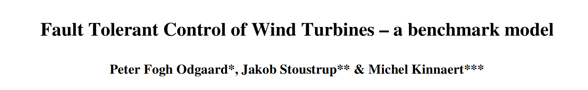
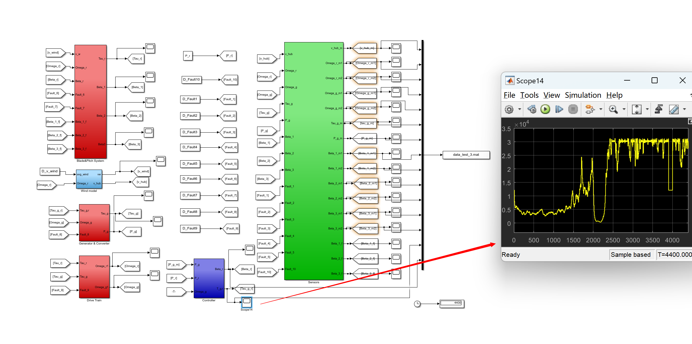
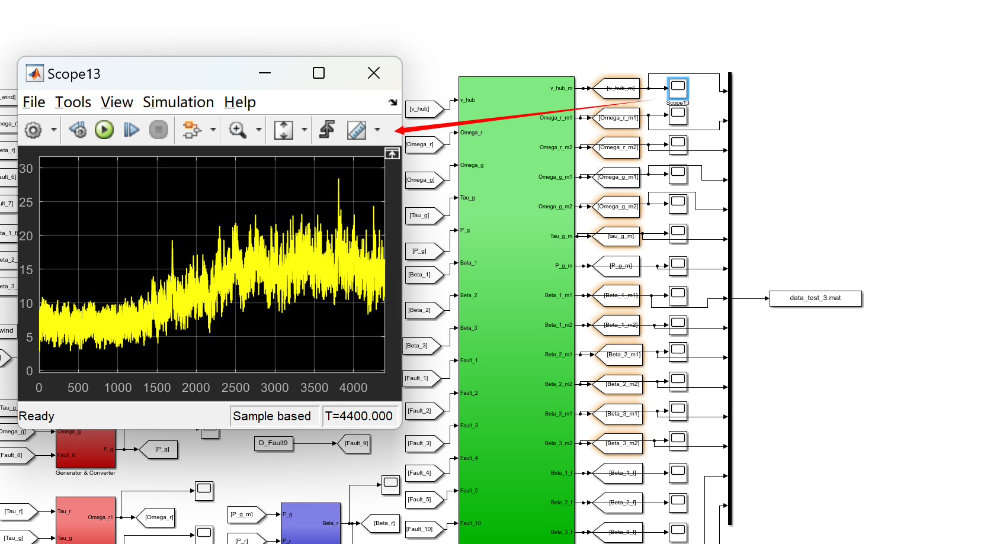
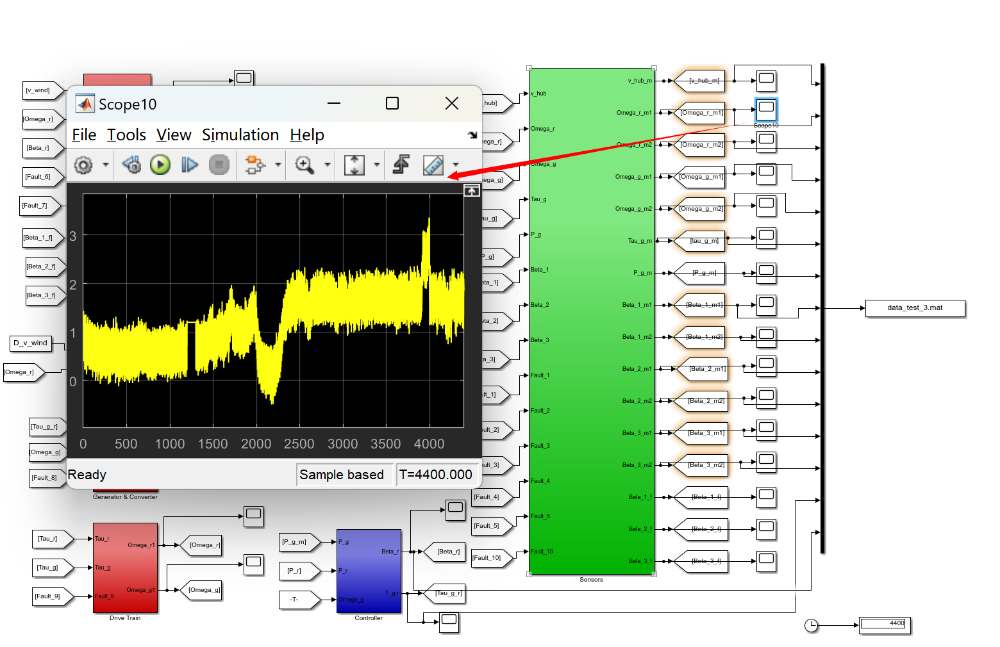
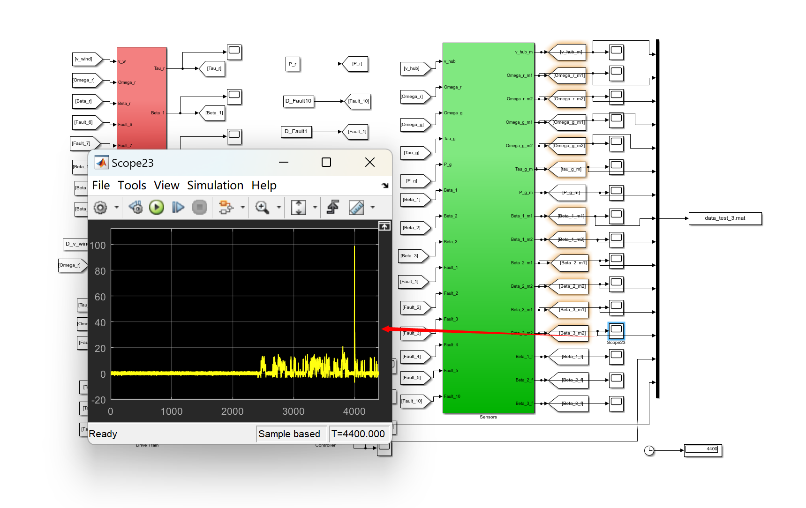
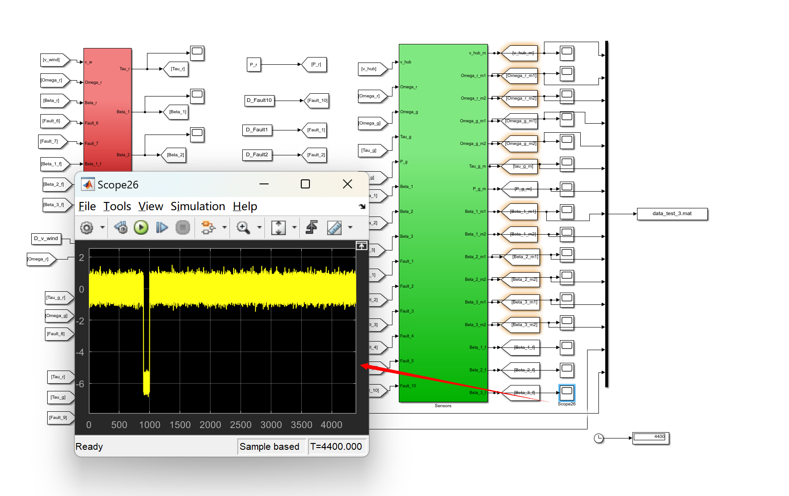
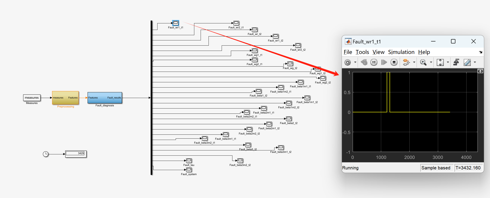
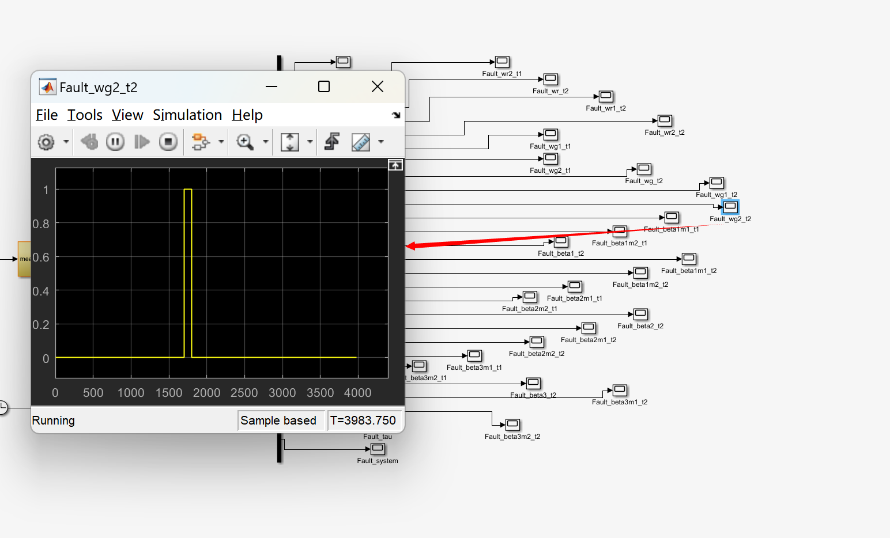

# Fault Detection for Wind Turbine with Fault Tolerant Control - Support Vector Machines for Wind Turbine Fault Detection (Matlab Code, Simulink Simulation)

[Fault Detection][Wind Turbine Fault Tolerant Control]Support Vector Machine for Fault Detection in Wind Turbines (Matlab Code, Simulink Simulation)
💥💥💞💞Welcome to this blog❤️❤️💥💥
🏆Bloggers' Advantage: 🌞🌞🌞The content of this blog is as rigorous and clear as possible to facilitate readers.
⛳️Mantra: A journey of a thousand miles begins with a single step.
📋📋📋This article is organized as follows: 🎁🎁🎁Table of Contents💥1 Overview📚2 Run Results🎉3 References🌈4 Matlab Code, Simulink, Data, Article
💥1 Overview
Document 1:
Editor
Abstract: Support Vector Machine (SVM) has been used for fault detection and isolation in variable-speed horizontal axis wind turbines. The turbine consists of three blades and a full converter. The SVM method is data-based, thus robust to process knowledge. Moreover, it is based on structural risk minimization, which enhances generalization capability by considering the nonlinearity of the process through the use of flexible kernels. In this work, the Radial Basis Function (RBF) was used as the kernel. The investigation covered different parts of the process, including actuators, sensors, and process faults. By replicating sensors, we can quickly detect sensor faults in the pitch position of blades, generator speed, and rotor speed (for fixed value faults, two sample cycles are required), but there are specific limitations in fault magnitude. Torque faults in the converter (one actuator) can be detected within two sample cycles. Faults in the pitch system actuator cannot be detected. Process faults mainly involve friction in the transmission system, which could potentially cause damage. With high magnitude error limits, they can be detected.
Keywords: Fault Detection, Support Vector Machine, Wind Turbine.
Article 2:
Editor
Abstract: The installed power generation capacity of wind turbines worldwide is rapidly increasing, which means the reliability of wind turbines is becoming more important. One task is to improve fault detection and fault-tolerant schemes for wind turbines. This paper proposes a benchmark model for simulating fault detection and fault-tolerant schemes. The benchmark model handles system-level wind turbines, including pitch systems, transmission systems, sensors, actuators, and system failures in generators and converters.
The common methods for fault diagnosis can be divided into two categories: model-based and data-based. The model-based approach requires a comprehensive system model. The success of the data-based approach depends on the importance of historical data and the mathematical method used to detect patterns in the data. In industrial systems, statistical methods are preferred when there is a large amount of data stored regularly and process models are not available. Among the statistical methods for fault detection and diagnosis, artificial neural networks, principal component analysis, and recently Support Vector Machines (SVM) have emerged. SVM is based on the structural risk minimization principle introduced by Vapnik and Chervonenkis in 1964. It was only recently that SVM was introduced as a machine learning algorithm for classification from two different classes of data. Essentially, a binary support vector classifier constructs a separate hyperplane. The hyperplane should have the maximum margin, i.e., the width between the boundary before hitting any data point on both sides. These contact points are called support vectors. To allow classification of nonlinear separable sets, non-linear kernel functions can be used. Therefore, the main difference between SVM and many other statistical methods is: first, structural risk minimization (traditional classifier training usually only minimizes the empirical risk), which improves generalization ability even with reduced sample size and avoids overfitting to achieve good parameter tuning. Second, SVM uses non-linear kernel functions, which allows for the separation of nonlinear separable data. SVM has been widely used to solve classification problems in many fields, including face, object, and text detection and classification, information and image retrieval, etc. Its application in fault detection began in 1999 and has been found to improve detection accuracy. Widodo and Yang (2007) proposed a literature review on the use of SVM for fault detection. They reported 37 papers on this topic in academic journals. Today, the number of journal papers using SVM for fault detection has almost doubled. The areas involved are mainly limited to mechanical equipment, such as roller bearings, gearboxes, power transmission systems, induction motors, turbine pump rotors, but have also expanded to other fields, such as electromechanical equipment, semiconductors, refrigeration systems, metal plate stamping, air conditioning systems, and a few chemical processes in the Tennessee Eastman benchmark test.
---------------------------  
Nowadays, wind turbines are playing an increasingly important role in global energy production, and the size of standard turbines is also increasing. The most commonly installed megawatt-level wind turbines are very expensive, so their reliability is crucial, with the aim to minimize downtime. A key aspect in ensuring this is the introduction of advanced fault detection, isolation, and adaptation systems into wind turbines. In the most advanced industrial wind turbines, fault detection and adaptation schemes are often simple and conservative. Therefore, using advanced fault detection, isolation, and adaptation methods can improve the reliability of turbines, although for certain faults, limited power generation may occur. Alternatively, condition monitoring can be used to monitor some mechanical components, such as gearboxes [Hameeda et al. (2009)]. There has been some research on model-based fault detection, isolation, and adaptation for wind turbines. In [Wei et al. (2008)], a feedback-based scheme was proposed for sensor fault detection in the drive system. In [Dobrila and Stefansen (2007)], a parity equation-based fault detection scheme was suggested. [Odgaard et al. (2009)] proposed an unknown input observer for detecting sensor faults around the wind turbine drive system. Fault detection in power conversion systems can be found in [Poure et al. (2007)].  
For more detailed articles, see Part 4.  
📚2 Running Results​Edit  
​Edit  
​Edit  
​Edit  
​Edit  
​Edit  
Waveform diagrams are numerous, but they will not be shown one by one.  
​Edit  
​Edit  
Part of the code:  
%% %%%%%%%%%%%%%%%%%%%%%%%%%%%%%%%%%%%%%%%%%%%%%%%%%%%%%%%%%%%%%%%%%%%%%%%%%  
c3=10;c4=1000;P_r=4.8e6;
% Simple time and time  
Ts=1/100;Time=Ts:Ts:4400;  
%%%%%%%%%%%%%%%%%%%%%%%%%%%%%%%%%%%%%%%%%%%%%%%%%%%%%%%%%%%%%%%%%%%%%%%%%%%  
%% Wind data  
%%%%%%%%%%%%%%%%%%%%%%%%%%%%%%%%%%%%%%%%%%%%%%%%%%%%%%%%%%%%%%%%%%%%%%%%%%%  
D_v_wind=[Time', 9+4*sin(0.01*Time)'];  
load winddata  
D_v_wind=[windtime windspeed];  
%% Wind Model  
seed1 = 256;  
seed2 = 894;  
turbulence_seeds=[seed1 seed2];  
R=57.5;  
H=87;  
k =4.7;  
a=2.2;  
alpha = 0.1;  
D_rotor=2*R;  
r = D_rotor/2;  
m = 1+alpha*(alpha-1)*R^2/(8*H^2);  
Length_scale = 600; %[m]  
L=Length_scale;  
Turbulence_intensity = 12;  
turb_int=Turbulence_intensity;  
T_sample=0.05;  
%%%%%%%%%%%%%%%%%%%%%%%%%%%%%%%%%%%%%%%%%%%%%%%%%%%%%%%%%%%%%%%%%%%%%%%%%%%  
%% Pitch and Blade Model  
%%%%%%%%%%%%%%%%%%%%%%%%%%%%%%%%%%%%%%%%%%%%%%%%%%%%%%%%%%%%%%%%%%%%%%%%%%%  
omega_n=11.11;xi=0.6;rho=1.225;  
R=57.5;r0 = 1.5;  
% cq table  
load AeroDynamics  
% Fault models  
% Fault 6  
xi2=0.45;omega_n2=5.73;  
% Fault 7  
xi3=0.9;omega_n3=3.42;  
%transfers to ss models  
[Apb,Bpb,Cpb,Dpb]=tf2ss([omega_n^2],[1 2*xi*omega_n omega_n^2]);  
[Apb1,Bpb1,Cpb1,Dpb1]=tf2ss([omega_n2^2],[1 2*xi2*omega_n2 omega_n2^2]);  
[Apb2,Bpb2,Cpb2,Dpb2]=tf2ss([omega_n3^2],[1 2*xi3*omega_n3 omega_n3^2]);  
%%%%%%%%%%%%%%%%%%%%%%%%%%%%%%%%%%%%%%%%%%%%%%%%%%%%%%%%%%%%%%%%%%%%%%%%%%%  
%% Drive Train Model  
%%%%%%%%%%%%%%%%%%%%%%%%%%%%%%%%%%%%%%%%%%%%%%%%%%%%%%%%%%%%%%%%%%%%%%%%%%%  
B_dt=775.49;  
B_r=7.11;  
B_g=45.6;  
N_g=95;  
K_dt=2.7e9  
eta_dt=0.97;  
J_g=390  
J_r=55e6  
Addt=[-(B_dt+B_r)/J_r B_dt/N_g/J_r -K_dt/J_r; eta_dt*B_dt/N_g/J_g -(eta_dt*B_dt/N_g^2+B_g)/J_g eta_dt*K_dt/N_g/J_g; 1 -1/N_g 0];  
Bddt=[1/J_r 0; 0 -1/J_g;0 0];  
Cddt=[1 0 0;0 1 0];  
Dddt=[0 0;0 0];  
% Fault models  
% Fault 9  
eta_dt2=.91  
Addt2=[-(B_dt+B_r)/J_r B_dt/N_g/J_r -K_dt/J_r; eta_dt2*B_dt/N_g/J_g -(eta_dt2*B_dt/N_g^2+B_g)/J_g eta_dt2*K_dt/N_g/J_g; 1 -1/N_g 0];  
Bddt2=[1/J_r 0; 0 -1/J_g;0 0];  
Cddt2=[1 0 0;0 1 0];  
Dddt2=[0 0;0 0];  
%%%%%%%%%%%%%%%%%%%%%%%%%%%%%%%%%%%%%%%%%%%%%%%%%%%%%%%%%%%%%%%%%%%%%%%%%%%  
%% Generator & Converter  
%%%%%%%%%%%%%%%%%%%%%%%%%%%%%%%%%%%%%%%%%%%%%%%%%%%%%%%%%%%%%%%%%%%%%%%%%%%  
alpha_gc=1/20e-3;  
eta_gc=0.98;  
%Fault models  
%fault 8  
Constant_tau_gc=100;  
%%%%%%%%%%%%%%%%%%%%%%%%%%%%%%%%%%%%%%%%%%%%%%%%%%%%%%%%%%%%%%%%%%%%%%%%%%%  
%% Controller  
%%%%%%%%%%%%%%%%%%%%%%%%%%%%%%%%%%%%%%%%%%%%%%%%%%%%%%%%%%%%%%%%%%%%%%%%%%%  
K_opt=.5* rho* pi*R^2*eta_dt*R^3*0.4554/(N_g*8)^3  
K_i=1;  
K_p=4;  
Omega_nom=162;  
Omega_delta=5;  
P_r=4.8e6;  
%%%%%%%%%%%%%%%%%%%%%%%%%%%%%%%%%%%%%%%%%%%%%%%%%%%%%%%%%%%%%%%%%%%%%%%%%%%  
%% Sensors  
%%%%%%%%%%%%%%%%%%%%%%%%%%%%%%%%%%%%%%%%%%%%%%%%%%%%%%%%%%%%%%%%%%%%%%%%%%%  
m_vw=1.5;  
sigma_vm=0.5;  
m_omega_r=0;  
sigma_omega_r=0.004*2*pi;  
m_omega_g=0;  
sigma_omega_g=0.05;  
m_tau_g=0;  
sigma_tau_g=90;  
m_P_g=0;  
sigma_P_g=1e3;  
m_Beta=0;  
sigma_Beta=0.2;  
%% Load SVM models of the various faults\n% Load the svm model of the sensor fault beta1m1 type fixed value\nload model_cap1_beta1m1 \n\n% Load the svm model of the sensor fault beta1m2 type fixed value\nload model_cap1_beta1m2 \n\n% Load the svm model of the sensor fault beta2 type gain factor\nload model_cap_beta2_t2\n\n% Load the svm model of the sensor fault omega_r_m1 type fixed value\nload model_cap1_wr1 \n\n% Load the svm model of the sensor fault omega_r_m2 type fixed value\nload model_cap1_wr2 \n\n% Load the svm model of the sensor fault omega_r_m2 type gain factor\nload model_cap_wr2_t2 \n  
🎉3 References
Editor
🌈4 Matlab code, Simulink, data, article

## Images

<!-- PAYMENT_BLOCK -->

## Get this dataset

- Payment link (Stripe): [Buy now](https://buy.stripe.com/3cs8yP7sY87d0vu9AB)
- Payment QR code: 

<!-- /PAYMENT_BLOCK -->
